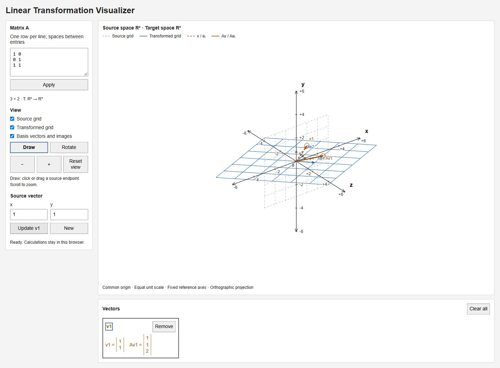

<div align="center">

# Linear Transformation Visualizer

**Linear algebra you can see · Lineare Algebra zum Ansehen**

Python · JavaScript · NumPy · SVG · Pyodide

[Live demo](https://julian-u03.github.io/linear-transformation-visualizer/) · [English](#english) · [Deutsch](#deutsch)

</div>



## English

Explore a linear map **T: Rⁿ → Rᵐ**, defined by **T(v) = A @ v**.
Enter a matrix with one to three rows and columns, then compare the source grid,
standard basis vectors and your own vectors with their images in one shared view.
The app starts with the **2D identity matrix and no user vectors**.

### What the screenshot shows

The matrix below maps a two-dimensional source onto the plane **z = x + y**:

```text
1 0
0 1
1 1
```

The source vector `(1, 1)` appears in the xy-plane at display position `(1, 1, 0)`;
its image is `(1, 1, 2)`. Coordinate readouts use column vectors and keep their
actual dimensions. Gray dashed lines show the source grid; blue solid lines
show its image. Both share the origin, reference axes, unit scale and camera.
Dashed and solid arrows distinguish each vector from its image, with matching
colors and explicit labels. The image of `eᵢ` is column `i` of the matrix.

### Using the app

- **Apply a matrix:** separate rows with newlines and entries with spaces or tabs.
  Decimal points and scientific notation are accepted. All nine shapes from
  1×1 through 3×3 work, including rectangular, zero and singular matrices.
- **Draw vectors:** use Draw mode to click or drag source endpoints. Enter precise
  source coordinates numerically, select pairs in the list, update or remove
  them, or clear all vectors. Image coordinates are calculated automatically.
- **Draw in 3D:** choose XY, XZ or YZ and the fixed remaining coordinate. With a
  two-dimensional source in a 3D view, drawing always intersects its xy-plane.
  Rotate an edge-on drawing plane before using it.
- **Inspect the view:** choose Rotate and drag with the left mouse button. This
  orbits a 3D camera or rotates a 2D view around the common origin. Scroll or use
  the zoom buttons; Reset view restores the camera and fits the complete scene.
  Source grid, transformed grid and basis arrows have visibility controls.
- **Edit safely:** drafts change the scene only after a successful Apply. Invalid
  input preserves the last applied result. Source vectors survive changes to the
  target dimension; changing the source dimension clears incompatible vectors.

This is an active transformation in fixed reference coordinates. Lower-dimensional
spaces are embedded along the x-axis or in the xy-plane for display only. The
matrix and numerical coordinates are never padded, clipped or normalized.

### How it works

| Layer | Responsibility |
| --- | --- |
| HTML / CSS | Plain desktop layout and accessible controls |
| JavaScript | Input events, recoverable applied state and worker coordination |
| SVG / camera | Shared 1D, 2D or orthographic 3D presentation and plane picking |
| Python / NumPy | Matrix parsing, Float64 products, source grid and image geometry |
| Pyodide Web Worker | Reuses Python without blocking the interface; rejects stale replies |

The complete static app lives in `docs/`, with no backend, package manager or build
step. On first use, **Pyodide 314.0.8**, NumPy and Pillow load from jsDelivr. Pillow
is part of the reference runtime stack and has no image-processing role here.
**Matrices and vectors stay in browser memory**; there is no analytics or persistence.
The interface is English, with a fixed desktop layout that scrolls on smaller screens.

Practical limits are centralized in `main.js`: matrix coefficients and source
coordinates have magnitude at most 10,000, up to 24 user vectors are allowed, and
the source grid spans −3 through +3. Labels are rounded; geometry uses full results.
Matrix changes and Reset view fit both spaces together; dragging never refits them.

For a local preview:

```sh
python -m http.server 8080 --bind 127.0.0.1 --directory docs
```

Open [localhost:8080](http://127.0.0.1:8080). The server only delivers files;
all mathematical calculations execute in the browser. An internet connection is
needed to load the runtime and packages.

## Deutsch

Untersuche eine lineare Abbildung **T: Rⁿ → Rᵐ** mit **T(v) = A @ v**.
Gib eine Matrix mit jeweils ein bis drei Zeilen und Spalten ein. Quellgitter,
Standardbasis und eigene Vektoren werden zusammen mit ihren Bildern in einer
gemeinsamen Koordinatenansicht dargestellt. Der Startzustand ist die
**2D-Einheitsmatrix ohne eigene Vektoren**.

Der Screenshot zeigt die oben angegebene 3×2-Matrix: Sie bildet die xy-Ebene auf
**z = x + y** ab. Aus `(1, 1)` wird `(1, 1, 2)`. Nur für die Darstellung erhält
der Quellvektor eine zusätzliche Nullkoordinate; seine Anzeige als Spaltenvektor
behält zwei Einträge. Grau gestrichelte Linien zeigen das Originalgitter, blaue
Linien das transformierte Gitter. Ursprung, Achsen, Maßstab und Kamera sind gemeinsam.

Mit **Apply** wird ein gültiger Matrixentwurf übernommen. Ungültige Eingaben lassen
die letzte gültige Szene stehen. Rechteckige Matrizen, Nullmatrizen und singuläre
Matrizen sind erlaubt. Ändert sich nur die Zieldimension, bleiben Quellvektoren
erhalten; bei einer neuen Quelldimension werden sie mit sichtbarem Hinweis entfernt.

Mit **Draw** lassen sich Vektoren zeichnen und ihre Endpunkte verschieben. Für
genaue Werte gibt es numerische Quellkoordinaten. Die Liste verbindet jeden
Vektor mit seinem berechneten Bild und ermöglicht Auswahl, Bearbeitung und Löschen.
Bei dreidimensionalen Quellen legen XY, XZ oder YZ und eine feste dritte Koordinate
die Zeichenebene fest. **Rotate** dreht die gemeinsame Ansicht per linker Maustaste;
Zoom und **Reset view** verändern ausschließlich die Darstellung.

Architektur und schlichtes Desktop-Design orientieren sich am
[SVD Image Compression-Projekt](https://github.com/julian-u03/svd-image-compression).
JavaScript steuert Oberfläche und SVG-Kamera, Python validiert Eingaben und
berechnet mit NumPy. Pyodide läuft in einem wiederverwendeten Web Worker.
Matrizen und Vektoren verlassen den Browser nicht. Für die lokale Vorschau genügt
der oben gezeigte HTTP-Server; ein Build-Schritt ist nicht erforderlich.

## Project structure / Projektstruktur

```text
docs/
  index.html                 Page and controls
  style.css                  Desktop layout
  main.js                    UI, limits, state and request revisions
  space-view.js              SVG, shared camera and drawing-plane intersection
  transformation-worker.js   Pyodide initialization and transport
  python/linear_map.py       Validation, grids and linear maps
screenshots/desktop.jpg      Current README capture; not used by the app
```

## Sources and notices / Quellen und Hinweise

Architecture and visual reference:
[SVD Image Compression](https://github.com/julian-u03/svd-image-compression).

Runtime/package licenses:
[Pyodide](https://github.com/pyodide/pyodide/blob/314.0.8/LICENSE) ·
[NumPy](https://numpy.org/doc/stable/license.html) ·
[Pillow](https://pillow.readthedocs.io/en/stable/about.html#license).

The screenshot shows the running application, using only its own SVG geometry.
No project source-code license has been selected.
Eine Lizenz für den eigenen Projektquellcode wurde noch nicht gewählt.
